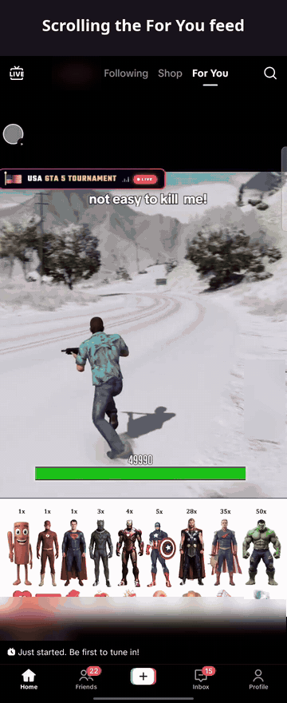
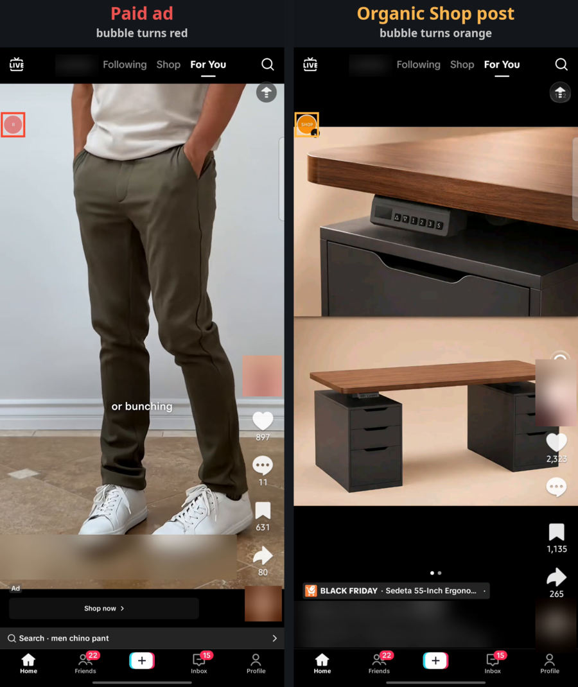
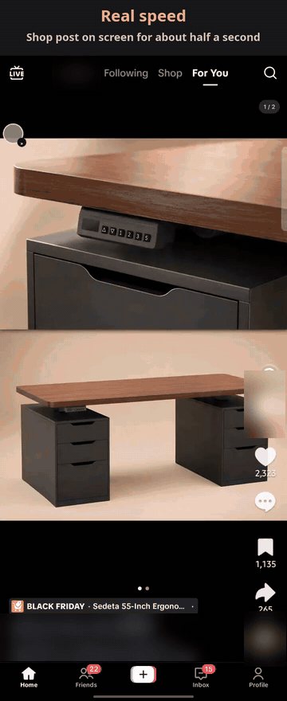

<div align="center">

# FeedClean

**Take back your TikTok For You feed.**
An Android app that spots paid ads, promoted posts and TikTok Shop pushes on your screen, flicks past the ones you
don't want, and helps you block the accounts behind them — on your phone, with your tap, nothing sent anywhere.

[](https://github.com/dreadnought-0/FeedClean/releases)
[](LICENSE)


[Download](#install) · [Features](#features) · [How it works](#how-it-works) · [Privacy](#privacy) · [FAQ](#faq) · [Build from source](#build-from-source)



<sub>Real capture on a Galaxy Z Fold 7. Creator names, captions and profile pictures are blurred.</sub>

</div>

> FeedClean is an independent open-source project. It is **not affiliated with, endorsed by, or sponsored by TikTok
> or ByteDance**. "TikTok" is named only to describe the app FeedClean works alongside.

---

## Why

A For You feed can end up half paid ads, "Promotional content", and TikTok Shop affiliate videos with a product
card. Blocking those accounts one by one is endless: new sellers, copycats and reposts keep coming.

FeedClean sits next to TikTok, reads what is **on your screen** (the same way screen readers do), and acts the moment
one of those posts appears:

- **Skips it** with one quick scroll, before you've really seen it.
- **Logs it**, so you can see who keeps showing up.
- **Blocks the account in one tap** when you decide to, checking every step so it never blocks the wrong person.
- **Tells TikTok "Not interested"** through TikTok's own menu, so the algorithm pushes less of it over time.

## Features

| | |
|---|---|
| 🔍 **Detection** | Paid ads ("Ad" / "Sponsored"), promoted & branded posts, TikTok Shop posts (product card), Shop sellers, and LIVE shopping previews. Paid ads and organic Shop pushes are told apart by TikTok's own disclosure label. |
| ⏭️ **Auto-skip** | Flagged posts flick past with a single scroll — **navigation only**, never an account action. Choose what to skip (organic Shop, paid ads, promoted, LIVE shopping) and **where** (For You, Following & other tabs, search results, profiles). Late-loading "Ad" tags and product cards are caught too. |
| 🛑 **One-tap verified block** | Tap the bubble → **Block**. FeedClean opens the profile, checks the @handle in TikTok's own confirmation dialog, confirms, and verifies "Unblock" appears. Any surprise → it stops and tells you. |
| 👎 **Assisted "Not interested"** | One tap sends TikTok's own "Not interested" feedback for the current post. |
| 🫧 **Bubble overlay** | A small dot over TikTok shows what's on screen (AD / PROMO / SHOP / LIVE). Tap for the action card; long-press to **pause all automation** instantly. |
| 📒 **Your own records** | Accounts, timelines of sightings and blocks, daily stats, tags, notes, and "possible impersonator" links. |
| 🔁 **Unblock audit** | Import TikTok's official "Download your data" export and see blocks that went missing or accounts that reappeared. |
| 🧾 **Decision log** | A 7-day, on-phone log of what FeedClean decided and why (never names or captions) — so "why wasn't this skipped?" always has an answer. |
| 📤 **Export / import** | Full backup (JSON + CSV) and a privacy-stripped public export, through the system file picker. |
| 🎛️ **Everything is a toggle** | Every behaviour has its own switch. Automation stays **off** until you turn it on. |

## See it in action

<p align="center">
  
  
</p>

<p align="center"><sub>Left: the bubble tells paid ads (red) from organic Shop posts (orange), using TikTok's own labels.
Right: auto-skip at real speed. Captured on a Galaxy Z Fold 7; names, captions and profile pictures are blurred.</sub></p>

## How it works

```
 TikTok on screen ──► Android accessibility tree (what a screen reader sees)
                               │
                               ▼
               ┌────────── FeedClean (on your phone) ───────────┐
               │  Selector file (tiktok.json) → Screen parser    │
               │        → Signals: Ad? Promoted? Shop? LIVE?     │
               │        → Your rules: skip what, and where       │
               │        → one scroll-forward   (auto-skip)       │
               │        → bubble + card        (your taps only)  │
               │        → local database + 7-day decision log    │
               └──────────────────────────────────────────────────┘
```

- FeedClean only ever sees **TikTok's screen** — its accessibility service is scoped to the TikTok app.
- Everything TikTok-specific (labels, view IDs, patterns) lives in one file,
  [`app/src/main/assets/selectors/tiktok.json`](app/src/main/assets/selectors/tiktok.json), so a TikTok update is a
  config fix, not a rewrite. You can even load a fixed selector file from Settings without reinstalling.
- **Auto-skip is a single scroll.** It never likes, follows, comments, opens profiles or taps products. It runs only
  while TikTok is in front, respects a consecutive-skip cap, and stops instantly on the kill-switch.
- **Blocks and "Not interested" always start from your tap**, are rate-limited (by default ≥ 5 s apart, ≤ 60 per
  hour, counted across restarts), and verify every screen before the next step.

### What FeedClean deliberately does *not* do

No reverse engineering of TikTok, no decompiling or patching, no certificate-pinning bypass, no private APIs, no
network interception, no editing of TikTok's cache or preloaded feed, no unattended or mass blocking, no analytics.
On a normal (non-rooted) phone, TikTok's preloaded queue and network traffic are sealed off by Android's app sandbox —
reaching into them would need root and would break with every update. Reacting to what's on screen gets the same
felt result ("I never watch these") safely, and survives TikTok updates.

## Install

1. **Download** `FeedClean-<version>.apk` from the
   [**latest release**](https://github.com/dreadnought-0/FeedClean/releases/latest). (Optional: check its SHA-256
   against `SHA256SUMS` in the release.)
2. **Open the APK** and allow your browser or file manager to install unknown apps when Android asks.
3. **Open FeedClean** → **Setup checklist** and follow it:
   - **Enable the service:** Settings → Accessibility → Installed apps → **FeedClean** → On, and accept Android's
     dialog.
   - **Toggle greyed out ("Restricted setting")?** Android 13+ restricts accessibility for apps installed from a
     browser or file manager. Go to Settings → Apps → FeedClean → ⋮ (top right) → **Allow restricted settings**, then
     enable the service.
   - **Battery:** set FeedClean to **Unrestricted** so the system doesn't stop it (Samsung: also consider "Never
     sleeping apps").
4. In FeedClean, turn on **Curate feed**, then open TikTok. A small bubble appears over TikTok.

Full walkthrough and troubleshooting: [docs/SETUP.md](docs/SETUP.md).

> **Requirements:** Android 13 or newer, the TikTok app (`com.zhiliaoapp.musically`) in English. Built and tested on
> Android 17 (One UI 9) with TikTok 47.7.3 and 47.9.3. Other languages and layouts may need
> [selector updates](docs/SELECTORS.md).
>
> **Updates:** releases are signed with the FeedClean release key, so newer versions install over older ones and
> keep your data. Builds you make yourself are signed differently and can't update a release install.

## Privacy

- **Everything stays on your phone.** Room database in app-private storage, cloud backup disabled, no analytics or
  crash reporting.
- **Reads only TikTok's screen.** Never other apps, and never the contact list in TikTok's share sheet.
- **One kind of network request, only when you tap it:** "Resolve" on a link you shared to FeedClean sends a single
  HTTPS `HEAD` to that short link to read the @handle. Nothing else ever goes online.
- **Exports are opt-in** via the system file picker; the public export strips names, notes, screenshots and timestamps.

Details: [docs/PRIVACY.md](docs/PRIVACY.md).

## Risks — please read

- **TikTok's terms restrict automated interaction.** FeedClean keeps things human-paced (tap-to-block, rate limits,
  step verification, scroll-only auto-skip), but the risk to your account is **not zero**. Use it on your own
  account, at your own risk.
- **Automated "Not interested"** (optional, off by default) is the most visible feature to TikTok; it carries an
  in-app warning and shares the rate limit with blocks.
- **TikTok changes its app often.** Detection can break after an update until the selector file is updated.

## FAQ

<details>
<summary><b>Why isn't this on Google Play?</b></summary>

Google Play's Accessibility API policy doesn't allow using an accessibility service to automate another app for
non-accessibility purposes, so FeedClean is distributed as an APK on the Releases page. Starting in 2026, some
certified Android devices may require apps installed outside Play to come from a verified developer; installs over
ADB are exempt.
</details>

<details>
<summary><b>Does it block ads automatically?</b></summary>

No. Blocking always needs your tap on the bubble's card. FeedClean can *skip* posts automatically (one scroll), and
you choose which kinds — by default it keeps paid ads and skips organic Shop pushes.
</details>

<details>
<summary><b>Will TikTok know?</b></summary>

FeedClean only reads the screen and performs ordinary scrolls and taps, at human pace. TikTok sees the same actions
you'd take yourself. Automated "Not interested" is the one optional feature that sends repeated feedback, which is
why it's off by default.
</details>

<details>
<summary><b>It stopped detecting things after a TikTok update.</b></summary>

Open FeedClean → Debug to see which selector stopped matching, and check the Decision log. Updating
[`tiktok.json`](app/src/main/assets/selectors/tiktok.json) (or loading a fixed copy from Settings → Detection) usually
fixes it. See [docs/SELECTORS.md](docs/SELECTORS.md), and please open a "selector breakage" issue.
</details>

<details>
<summary><b>Does it work on the unfolded screen of a foldable?</b></summary>

Yes in practice; it reads the live window size. Most testing so far has been on a Galaxy Z Fold 7's cover screen.
</details>

<details>
<summary><b>Can I share my block list with others?</b></summary>

You can export a privacy-stripped public list (Settings → Data & privacy → Public export) and share the file
yourself. There is no built-in sharing service: FeedClean never uploads anything.
</details>

## Build from source

Requires Android Studio (or a JDK 17+, e.g. Android Studio's bundled JBR) and the Android SDK with platform 37.

```sh
git clone https://github.com/dreadnought-0/FeedClean.git
cd FeedClean
export JAVA_HOME=/opt/android-studio/jbr      # Linux example; any JDK 17+ works
./gradlew :app:assembleDebug                   # → app/build/outputs/apk/debug/app-debug.apk
./gradlew :app:testDebugUnitTest               # ~700 JVM tests, incl. parser tests on scrubbed screen captures
```

Release builds are signed only if `FEEDCLEAN_RELEASE_*` properties are set in your *user-level*
`~/.gradle/gradle.properties` (never in the repo); otherwise `assembleRelease` produces an unsigned APK.

**Tech:** Kotlin · Jetpack Compose (Material 3) · Navigation 3 · Room · DataStore · kotlinx.serialization ·
coroutines/Flow · AccessibilityService · manual DI. Single module, organised by package:

```
app/src/main/
├── assets/selectors/tiktok.json   every TikTok label, ID and pattern (the only TikTok-specific file)
└── java/.../feedclean/
    ├── detect/     screen parser, signal detector, curation policy (pure Kotlin, JVM-tested)
    ├── service/    accessibility service, screen driver, pipeline, decision log
    ├── curate/     auto-skip controller, "Not interested" flow
    ├── block/      verified block flow, shared rate limiter
    ├── overlay/    bubble and action card
    ├── data/       Room database and repositories
    ├── share/ io/ audit/   share target, export/import, unblock audit
    └── ui/         Compose screens
```

How detection is configured, and how to update it after a TikTok release: [docs/SELECTORS.md](docs/SELECTORS.md).

## Contributing

Bug reports, selector fixes for new TikTok versions, and translations of selectors for other languages are very
welcome. Please read [CONTRIBUTING.md](CONTRIBUTING.md) first — in particular, **never attach raw screen captures**
(they contain names); the docs explain how to scrub them. Security issues: [SECURITY.md](SECURITY.md).

## License

[Apache License 2.0](LICENSE) — see also [NOTICE](NOTICE).

TikTok is a trademark of its respective owner. FeedClean is not affiliated with TikTok or ByteDance.
