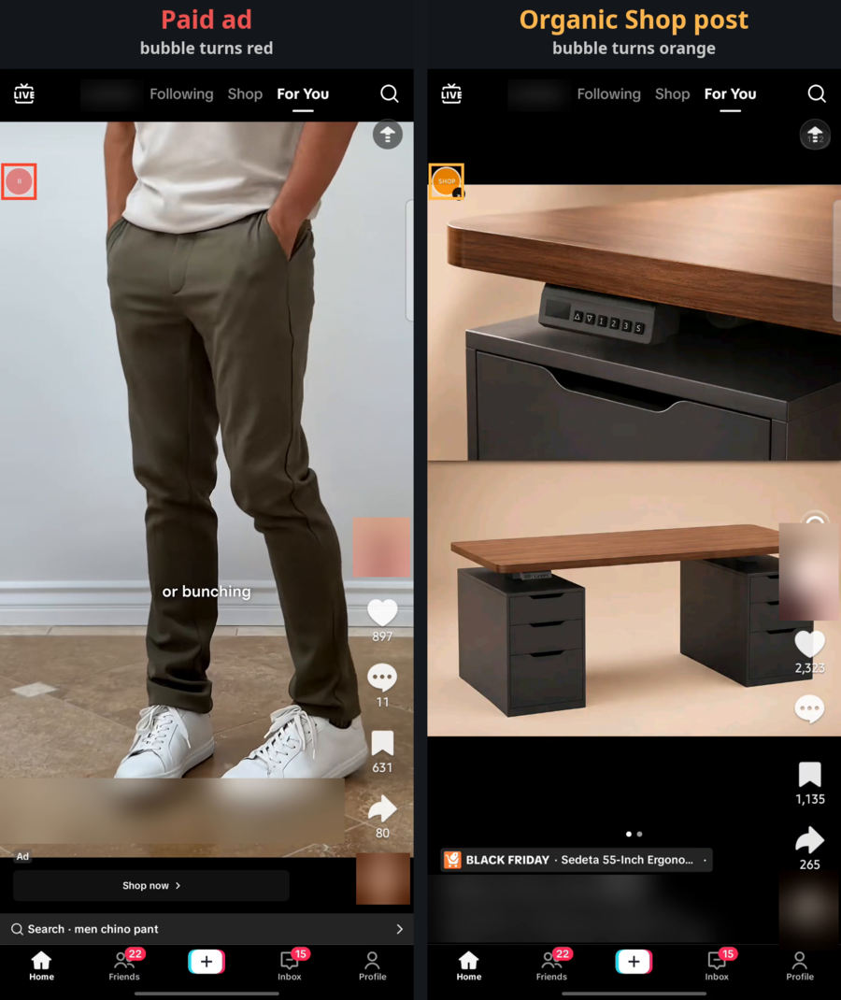
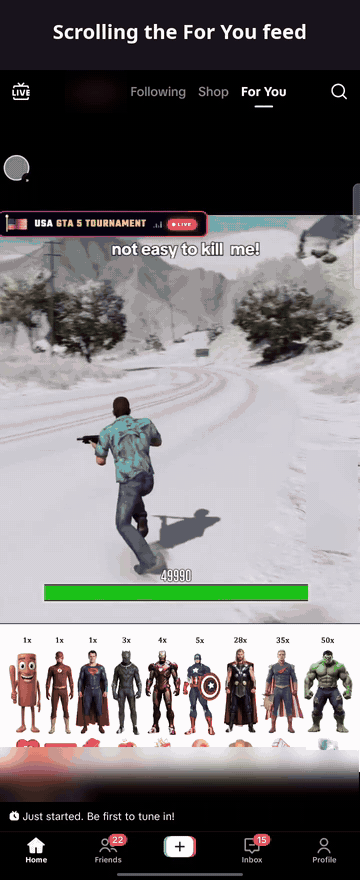
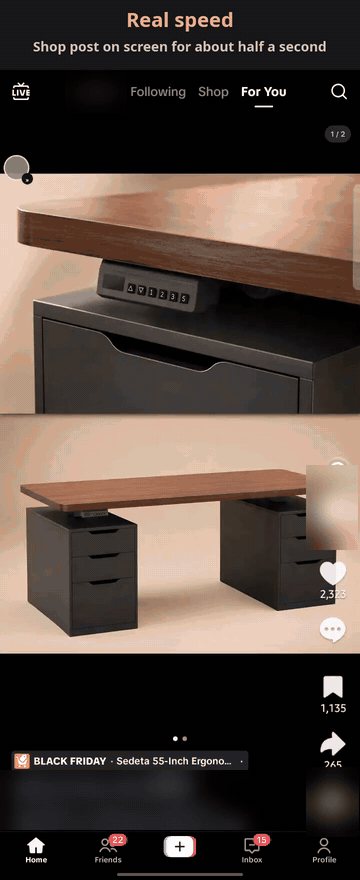
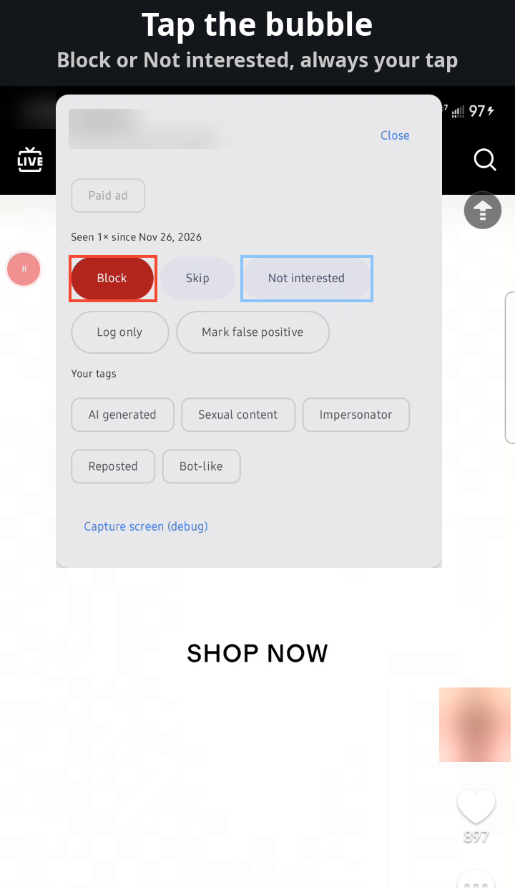

# FeedClean features

Every capture on this page was recorded on a Galaxy Z Fold 7 (cover screen) running TikTok 47.9.3. Creator names,
@handles, captions, profile pictures and the status bar are blurred.

- [Detection](#detection)
- [Auto-skip](#auto-skip)
- [The bubble and the action card](#the-bubble-and-the-action-card)
- [One-tap verified block](#one-tap-verified-block)
- [Assisted "Not interested"](#assisted-not-interested)
- [Pause everything](#pause-everything)
- [Your records and stats](#your-records-and-stats)
- [Decision log](#decision-log)
- [Settings: everything is a toggle](#settings-everything-is-a-toggle)

## Detection

FeedClean reads what TikTok puts on screen (the same information a screen reader gets) and labels each post the
moment it appears. Paid ads and organic Shop posts are told apart by TikTok's own labels: a paid ad carries the
"Ad" / "Sponsored" disclosure; an organic Shop post has a product link but no ad label.

| Bubble | Meaning |
|---|---|
| Grey | Nothing flagged |
| Red · AD | Paid ad ("Ad" / "Sponsored") |
| Orange · SHOP | Organic Shop post (product link, no ad label) or a known Shop seller |
| PROMO | Promoted or branded content ("Promotional content", paid partnership) |
| LIVE | LIVE shopping preview in the feed |

## Auto-skip

Pick what to skip (organic Shop, paid ads, promoted, LIVE shopping) and where (For You, Following and other Home
tabs, search results, profiles, hashtags and sounds). When a flagged post lands, FeedClean sends a single
scroll-forward. That's all it does: no likes, follows, taps on products or profile visits.

  
  

Labels that load late (an "Ad" tag or product card that appears a moment after the video) are caught by a short
watch window. A consecutive-skip cap and the pause switch stop it if anything looks wrong.

<!-- TODO capture: Settings → Curate feed, "What to auto-skip" and "Where to auto-skip" -->

## The bubble and the action card

Tap the bubble for the action card: **Block**, **Skip**, **Not interested**, **Log only**, **Mark false positive**,
and your own tags. Nothing on the card runs unless you tap it.

## One-tap verified block

Tap **Block** on the card and FeedClean walks TikTok's own block flow for you: it opens the profile, checks the
@handle, opens the share sheet, taps Block, confirms in TikTok's dialog, and checks that "Unblock" appears. If any
screen isn't what it expects, it stops and tells you which step failed. Blocks are rate-limited (by default at least
5 s apart and at most 60 per hour, counted across restarts).

<!-- TODO capture: Block run end to end on an organic Shop seller (share-sheet contacts blurred) -->

## Assisted "Not interested"

Tap **Not interested** on the card and FeedClean opens TikTok's long-press menu and taps TikTok's own
"Not interested". It's manual by default; an opt-in mode can send it automatically alongside auto-skip, with an
account-risk warning and the same rate limit as blocks.

<!-- TODO: handle the "Why aren't you interested?" reason sheet TikTok shows for paid ads, then capture the full run -->

## Pause everything

Long-press the bubble to pause all automation instantly; detection keeps running so you can still see what's on
screen. Long-press again (or use Home) to turn it back on.

<!-- TODO capture: long-press pause and resume -->

## Your records and stats

Every account FeedClean flags or you block is kept on your phone: sightings, blocks, tags and notes, plus daily
stats and 14-day charts. Accounts known only by a display name are marked "possible" until a block confirms the
@handle.

<!-- TODO capture: Accounts list (handles blurred), Stats -->

## Decision log

A 7-day, on-phone log of every decision: which labels were seen, whether the post was kept or skipped, and why
(for example "paused" or "not enabled here"). It never stores names or captions. Open it from Debug.

<!-- TODO capture: Debug → Decision log -->

## Settings: everything is a toggle

Detection, each auto-skip target and place, skip timing, the bubble, Not interested, block style and rate limits
each have their own switch. Automation stays off until you turn it on.

<!-- TODO capture: Settings sections, Home quick toggles, Setup checklist -->
